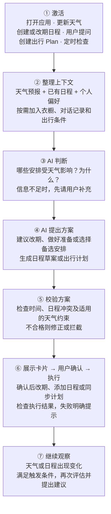

# Daycast｜让天气进入今天的安排

> 当前版本：**0.8.6**（2026-10-13）。

天气 App 从来不缺，缺的是一个在生活被天气打乱之前，先替你想一步、先开口的助手。

打开 Daycast 的「今天」页，它会结合天气、日程和你的偏好，留意接下来的安排：户外拍摄可能遇雨，就提前提出改期建议；固定的出门安排不方便调整，就提醒你做好准备；父母所在的城市降温了，也会让你想起递一句添衣的问候。你不用每件事都问一遍，它会把值得注意的变化带到眼前。

有些想法还没敲定，去「聊聊」随口问一句：“今天去露营，合适吗？”它会根据已有天气信息说明风险，结合你的衣橱和偏好给出建议。聊出一个合适的安排，就生成日程草案，等你确认后再保存。

真要出趟远门，「出行 Plan」会先梳理目的地天气、日历空档、衣橱与个人偏好，只追问影响行程的必要信息，再给出逐日安排、穿搭、打包清单和天气备选。确认后，整份计划才会进入日历。开启天气监测后，只要应用保持运行，它还会定时核对目的地预报，发现变化便起草调整方案，交给你决定。

建议也要经得起检查。改期撞上“接孩子”，应用会把冲突交回 AI，让它重新推敲；确认执行后，还会重新读取日程，核对修改结果。暂时没有合适方案，就把风险说清楚，留住原来的安排。

你的衣橱、习惯、日程与远方的牵挂，都可以在「我的」页里整理。每多记下一点真实生活，Daycast 的建议就多一份依据。

**Daycast，让天气进入今天的安排。**

## Agent 流程

Daycast 的 Agent 闭环：**激活（你说话 / 打开应用 / 日程变更 / 定时轮询）→ 应用打包上下文 → AI 判断（意图、受影响吗、信息够吗）→ AI 提方案（回答 / 草案 / 四类处理卡 / 出行计划）→ 应用校验（失败回喂修正一轮）→ 你确认 → 执行并读回核验 → 继续观察**。



## 讲解视频

0.8.6 讲解视频录制中，稍后更新。

旧版宣传片（画面基于 0.4.3，与当前界面有差异，不作为完整实测的证明）：**[观看 Daycast × Onway 宣传片（2 分 40 秒）](https://github.com/buqizixv/shaotangjiabing/releases/download/v0.4.3/Daycast-Onway-promo-remix.mp4)**

## OctoSense 系统 AI 与 Daycast 如何协作

Daycast 的集成基于 manifest 声明的 `octos.session.open` 与 `octos.turn.start` 能力。应用可以打开由宿主管理的助手会话，并提交这一轮与当前任务有关的内容。OctoSense 管理模型提供方、凭据及宿主侧的工具和授权；Daycast 不内置或收集模型 API Key。

```text
用户在 OctoSense 对话中提出任务
                  ↓
OctoSense 系统 AI 将任务交给 Daycast 个人通道
                  ↓
Daycast 结合天气服务与应用内相关资料处理
                  ↓
返回解释、建议或待确认草案
                  ↓
用户确认后，Daycast 才保存个人资料
```

系统 AI 能使用应用的专门能力，应用则以明确的数据边界和可确认的操作承接任务。用户不必在多个孤立工具间重复描述同一件事，也能看清每项资料何时会被保存。

### Agent 能力对照

| 维度 | Daycast 的做法 | 可核对的位置（`bundle/main.splash`） |
| --- | --- | --- |
| 理解状态 | 判定前打包未来 3 天日程、逐小时预报、个人偏好、衣橱；信息不足时出澄清卡或只问一道选择题 | `request_task_suggestions`、`send_weather_question` |
| 多步执行 | 草案 → 校验 → 确认 → 写入 → 读回核对，五步成链 | `reschedule_event`、`confirm_ai_event` |
| 跟进变化 | 每 10 分钟比对日程/预报/偏好指纹，有有效变化才调模型；出行监测命中天气分支后 AI 自动起草调整方案 | `poll_task_suggestions`、`check_trip_weather` |
| 可靠结果 | 校验失败的原因回喂 AI 修正一轮，仍失败转为风险说明卡；改期"加-删-失败回滚"并读回核验 | `validate_ai_tasks`、`task_model_round` |

## 八项关键决策

| # | 决策点 | 结论 |
| --- | --- | --- |
| 1 | 天空页形态 | 作子页保留，今天页"完整天气 →"进入，不占导航位 |
| 2 | 影响判定 | 降水 50% / 35°C / 0°C 参考线写死为 AI 上下文，结合个人偏好收紧；**受影响就必须报告**——改期、提前准备、暂无可行方案、需补充信息都是正式结果，空数组只代表"都正常" |
| 3 | 户外判定 | 不加室内/室外字段；AI 读日程标题与时间做语义判断（通勤路上淋雨也算）；触发时机：打开应用、日程变更后、每 10 分钟（仅应用打开期间，指纹无变化不调模型） |
| 4 | 改期写入 | 应用侧"加新 → 删旧 → 失败回滚删新"，成功后重新读取日程列表核对——"新的在、旧的没了"才显示成功，否则提示"结果待核对"；不依赖宿主改动 |
| 5 | 预报边界 | 只判定 3 天内的日程，不向用户展示"之后暂无预报"的噪音 |
| 6 | 演示任务 | 真实任务不足时保留演示卡片，保证首页可感知 |
| 7 | 问答页边界 | 照常回答已保存日程的问题；确认卡片搬进对话内，与今天页同一写入路径 |
| 8 | 出行监测 | 天气分支命中后由 AI 自动起草调整方案，用户确认、应用校验后才写入 |

## 功能与使用说明

### 1. 今天页：看天气，也看安排受不受影响

展示实况、体感、最高/最低温、降水概率、紫外线、风速与天气实景背景，逐小时预报和温度曲线一目了然；AI 出门建议结合你的偏好、衣橱和当日日程。

**建议任务卡（核心）**：AI 语义判定未来 3 天的日程在执行过程中（包括往返路上）会不会遇到明显不利的天气——参考线为降水概率 50%、35°C、0°C，你的偏好可以收紧这些界限。受影响必须报告，四种结果都会出卡：**确认改期**（附应用自算的前后对比数字）/ **提前准备**（可引用衣橱已有衣物）/ **暂无理想方案** / **需补充信息**（一键跳问答页继续）。判定在打开应用、日程变更后和应用打开期间每 10 分钟触发；模型不可用时回落到规则判定。

**怎么用：**打开即看；点城市名进入城市管理，切换或搜索添加地点；点“完整天气 →”进天空子页看逐小时与七天趋势；点刷新更新天气。

### 2. 问答：聊聊还没定的想法

开放式提问，或选四个任务入口之一：**创建日程、添加衣物、创建天气偏好、添加家庭城市**。对话携带最近 12 条消息和尚未保存的草案，支持连续追问。日程草案会先说明时间、冲突检查和天气参考，你点“确认并添加”才写入。问及已保存日程的天气影响时照常回答，并可在对话内直接给出待确认的改期卡——与今天页的建议任务卡走同一条写入路径。

**怎么用：**输入自然语言发送；核对草案卡片后确认或忽略。

### 3. 出行 Plan：多日远行，认真规划

从一句出行想法开始：先盘点目的地天气、实际衣橱、天气偏好和日历空档，缺口只补问少量选择题——模糊的“某个周末”会给出日期选项，不替你做默认。计划包含逐日安排、已有衣物穿搭、打包清单和雨天/低温备选（天气分支流程图）；写入前再次验证目的地、日期、衣橱和日历空档，你检查并确认后才同步到 Daycast 日程与 OctoSense 系统日历——冲突时不部分写入，同一版本重试幂等。开启天气监测后，应用打开期间定时核对目的地预报，命中天气分支时由 AI 起草调整方案，交给你决定。

**怎么用：**说出出行日期、目的地、同行的人和在意的事；任何时候都可暂停，草稿会保留。

### 4. 我的：家底和牵挂的信息仓

衣橱（类型 + 存放位置，照片只存本机）、日程表、天气偏好（怕冷/怕热/自定义阈值）、家庭城市与 Rinx 天气提醒开关都汇总在这里。其他页面从这里取数；每项资料都可以通过问答起草、确认后保存，也可以手动管理。

## 产品理念

### 从天气数据到生活行动

天气数值本身不是答案。“骑车要不要加衣”“带不带伞”“这项安排放在几点合适”才是。Daycast 把天气和你愿意记录的衣物、偏好、日程放在一起，让建议落到行动上。

### 把天气关注延伸到家人身边

记下父母家人居住的城市，在同一个 Daycast 里照看异地的天气。那边降温、降雨了，你更容易想起递一句提醒。

### AI 起草，人决定，应用校验

AI 负责理解和建议，应用负责数据约束与校验，最终决定权在你。任何写入都要你亲手确认；执行结果会被重新读取核对。

## Daycast 的特点

| 用户需要 | Daycast 提供的能力 |
| --- | --- |
| 天气会不会打乱安排，不想自己逐条查 | 今天页主动出建议任务卡：改期 / 准备 / 说明 / 澄清四类结果，附前后天气对比数字。 |
| 有想法还没定，想随口问一句 | 问答页结合天气、衣橱、偏好回答，聊好了可一键生成日程草案。 |
| 多日远行要认真规划 | 出行 Plan 完整规划、确认后同步日历，天气监测持续跟进。 |
| 担心 AI 未经同意改资料 | 所有写入都先出草案，校验后仍需确认；改期带回滚和读回核对。 |
| 想理解建议从何而来 | 卡片印着应用自算的天气对比（如“原时段降水 70% → 新时段 10%”），问答回复说明依据。 |
| 惦记异地家人的天气 | 家庭城市关注列表，天气变化时可经 Rinx 提醒你（发送需你确认）。 |
| 在意个人资料和照片边界 | 生活资料保存在应用私有空间；衣物照片留在本机，不发给天气服务或 AI。 |

## 数据、权限与隐私

- **天气数据：**Open-Meteo Forecast API 根据所选地点的经纬度提供天气信息；地区搜索使用和风 GeoAPI（凭据保存在本机宿主私有配置）。
- **生活资料：**当前城市、偏好、衣橱、日程、家庭城市和提醒开关写入 OctoSense 分配给 Daycast 的应用私有存储。
- **AI 上下文：**问答、出门建议与日程影响判定会把相关的天气、日程、偏好、衣橱文本交给宿主助手处理；提供方与凭据由 OctoSense 管理，Daycast 不内置或收集 API Key。
- **衣物照片：**存储在应用私有空间，不发送给天气 API 或 AI。
- **写入控制：**AI 提出的日程、衣物、偏好、家庭城市和改期草案都要由你确认后才保存。
- **定时检查：**日程影响（10 分钟）、家庭城市（15 分钟）、出行天气监测（30 分钟）只在应用打开期间运行，关闭应用即全部停止；不提供后台推送。

## 运行与配置

Daycast 使用 OctoScript 编写，主要源码是 [`bundle/main.splash`](bundle/main.splash)。在已准备 OctoScript-App-Design-Flow 与 OctoSense App Hub 工具的环境中：

```powershell
python <OctoScript-App-Design-Flow 路径>\tools\octo check bundle
python <OctoScript-App-Design-Flow 路径>\tools\octo run bundle --port 8141
python <OctoScript-App-Design-Flow 路径>\tools\octo shot 8141 preview.png
```

Daycast 是“应用 bundle + 配套宿主补丁”两件套，完整功能需要：

1. **配套宿主：**在 OctoSense `127ae4b` 工作树应用 `host-integration/octosense-daycast.patch`，并同步 `host-integration/host-service/` 后重新编译——只装 bundle 没有日程、出行 Plan、地区搜索和 Rinx 服务，接入细节见 [host-integration/README.md](host-integration/README.md)。
2. **模型配置：**在 OctoSense 中配置 AI 提供方与凭据。
3. **和风 GeoAPI 凭据（地区搜索需要）：**`~/.config/octosense/qweather/config.json`，见 [host-integration/QWEATHER.md](host-integration/QWEATHER.md)；天气预报本身使用 Open-Meteo，免凭据。
4. **网络：**`api.open-meteo.com`、`geocoding-api.open-meteo.com` 与和风域名可达。

**验证边界：**商店安装流程、Android/iOS 端、与最新 OctoSense 主分支的适配均未验证；Windows 运行时暂不支持相机源，衣物拍照不可用。

许可证为 Apache-2.0，见 [LICENSE](LICENSE)。

## 贡献

在开发和联调 Daycast 的过程中，GitHub 账号 [buqizixv](https://github.com/buqizixv) 向 OctoSense 生态提交了以下问题反馈、接口改进请求和应用投稿，涵盖 Windows 渲染与依赖交付、应用托管、模型状态协议及发布流程。

截至 **2026-10-13**，共 **15 条 Issue：14 条开放，1 条已完成关闭**。状态以原 Issue 的最新记录为准。

### OctoSense：桌面体验与宿主集成

| Issue | 问题或请求 | 当前状态 |
| --- | --- | --- |
| [#530](https://github.com/OctoSense-org/OctoSense/issues/530) | 请求 Windows 摄像头预览/拍摄支持，以及可发现的运行时能力状态。 | 开放 |
| [#527](https://github.com/OctoSense-org/OctoSense/issues/527) | 反馈 Splash 页面初次打开时部分文字缺失、等待后恢复的偶发现象。 | 开放 |
| [#526](https://github.com/OctoSense-org/OctoSense/issues/526) | 反馈本地 release 启动缺少 WebView2Loader.dll，并请求核查依赖交付流程。 | 开放 |
| [#525](https://github.com/OctoSense-org/OctoSense/issues/525) | 反馈 Windows Dock 中部分应用只显示空白底板、SVG 图标内容不可见。 | 开放 |
| [#338](https://github.com/OctoSense-org/OctoSense/issues/338) | 请求补足 peer/prepare 的模型状态信息，区分已连接与没有可用模型。 | 开放 |
| [#337](https://github.com/OctoSense-org/OctoSense/issues/337) | 反馈 Bundle 图标路径、摘要计算及应用更新流程容易出现静默失败。 | 开放 |
| [#336](https://github.com/OctoSense-org/OctoSense/issues/336) | 反馈 ContextOp::Turn 将内部提示词混入用户可见的对话记录。 | 开放 |
| [#335](https://github.com/OctoSense-org/OctoSense/issues/335) | 反馈文档中的 apps.splash 配置未被读取，应用托管静默降级为进程。 | 开放 |
| [#286](https://github.com/OctoSense-org/OctoSense/issues/286) | 反馈进程托管应用无法通过 shell broker 获取 Octos 服务。 | 开放 |
| [#285](https://github.com/OctoSense-org/OctoSense/issues/285) | 反馈桌面内核发现逻辑忽略 core/bin 位置。 | 开放 |
| [#136](https://github.com/OctoSense-org/OctoSense/issues/136) | 反馈 AppModule::create 的上下文调用要求缺少说明，panic 难以定位。 | 开放 |
| [#135](https://github.com/OctoSense-org/OctoSense/issues/135) | 反馈 AI bus 服务 ID 与模块 ID 的连字符规则不一致，验证错误不明确。 | 开放 |
| [#134](https://github.com/OctoSense-org/OctoSense/issues/134) | 反馈 --module 参数未打开指定模块，实际表现与文档不一致。 | 开放 |

### Octos：模型状态协议

| Issue | 问题或请求 | 当前状态 |
| --- | --- | --- |
| [#2674](https://github.com/octos-org/octos/issues/2674) | 请求 peer/prepare 返回可安全展示的模型名称。 | 已完成关闭；关联 [PR #2711](https://github.com/octos-org/octos/pull/2711) |

### App Hub：应用投稿

| Issue | 问题或请求 | 当前状态 |
| --- | --- | --- |
| [#111](https://github.com/OctoSense-org/OctoSense-App-Hub/issues/111) | 提交 Daycast / weather-assistant 0.4.3 到 App Hub，已有初步评审回复。 | 开放；已有评审反馈 |
