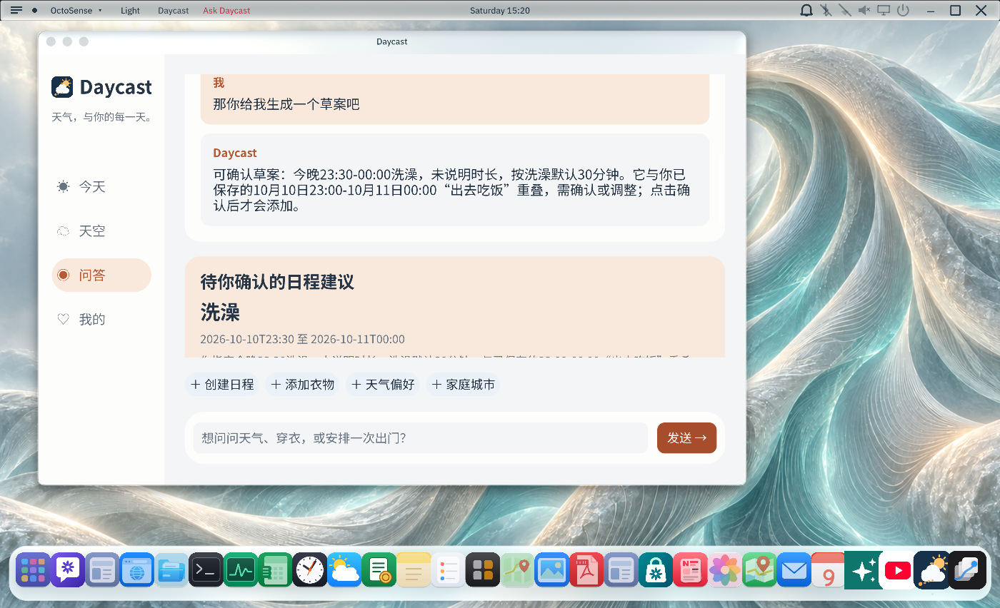
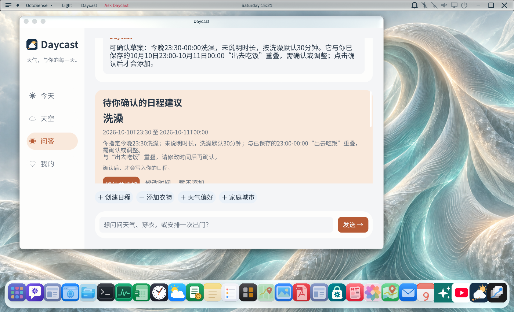

# 连续对话与日程草案验证

2026-10-10，在更新后的 Windows `octosense.exe` 中通过实际 `model.complete` 服务验证。应用资料和日程使用隔离的 `OCTOSENSE_HOME`，测试日程为“出去吃饭”23:00–次日 00:00 和次日“短会”08:00–09:00。未向真实日程添加事项。

## 修复内容

- 普通聊天原先使用空的操作模式，导致模型返回的日程草案被忽略；现在统一为 `chat`，显示待确认卡片。
- 问答原先只提交最新一句；现在提交最近 12 条前文消息及未保存草案，保留用户与助理角色。
- 明确要求模型输出结构化草案，并区分指定时间、建议时间、未保存草案与已保存日程。
- 草案展示本地检查出的日程冲突；确认发生冲突时保留草案供修改。

## 实际对话

1. 输入“我今天晚上11点半要洗澡”：显示“洗澡”草案，时间为 2026-10-10 23:30–2026-10-11 00:00，说明默认时长 30 分钟及与吃饭的冲突。
2. 接着输入“那你给我生成一个草案吧”：继续显示同一洗澡事项及时间，没有再次询问活动名称。
3. 在隔离资料中点击“确认并添加”：提示冲突，草案仍可修改，存储中的日程保持原来的两项。

## 验证范围

`cargo test --locked --offline --release -p octosense-llm-service --test weather_advice` 的 24 项测试通过，其中包含普通聊天草案、历史上下文、冲突保留、历史长度与角色、迟到回复隔离的回归测试。

`cargo build --locked --offline --release -p octosense --bin octosense` 通过，实际界面测试使用此次构建的程序。商店 bundle 已重新 stamp，`hub check --allow-unsigned` 通过。真实模型验证覆盖上述两轮对话；其他说法与模型配置的效果仍需各自验证。
