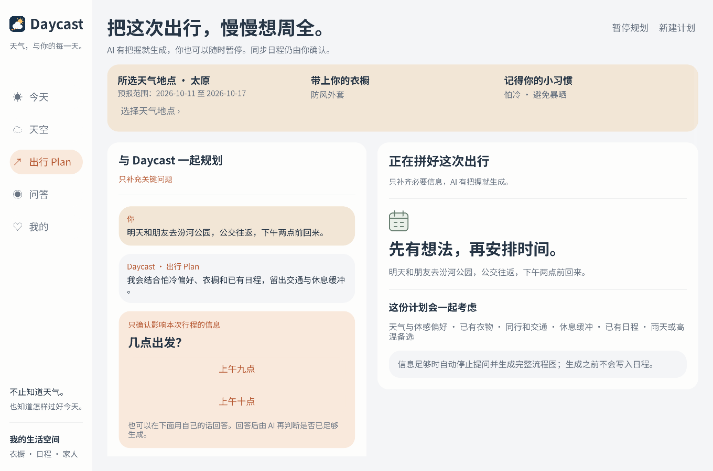
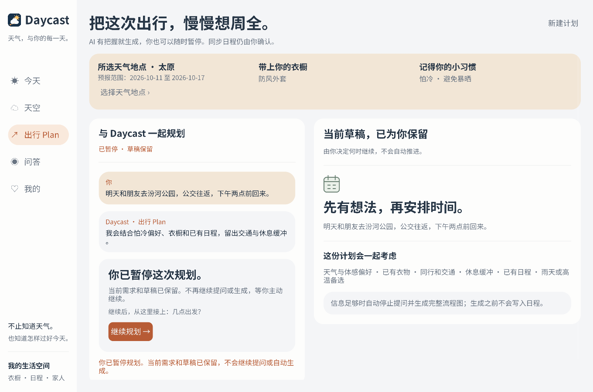
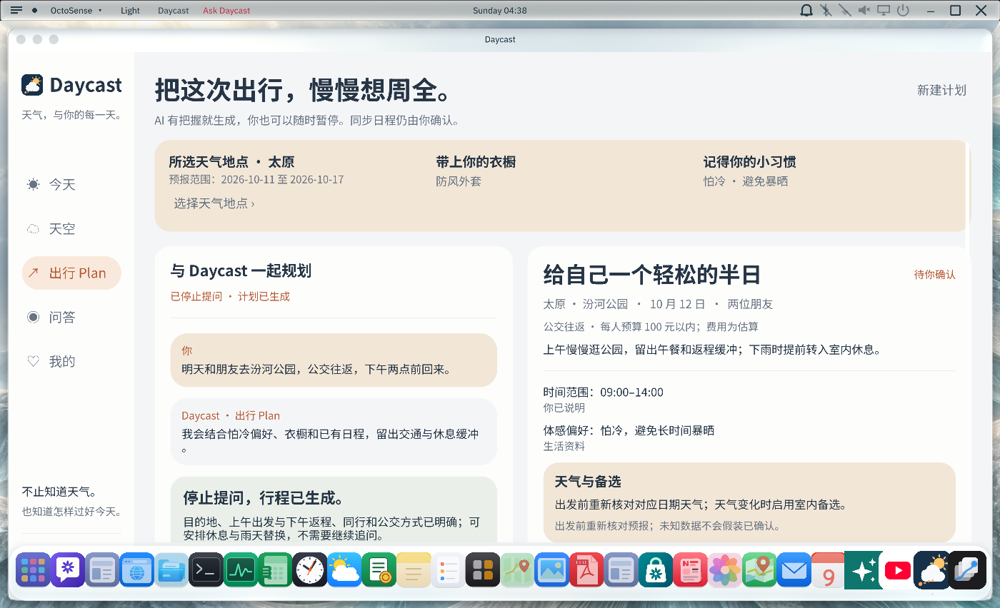
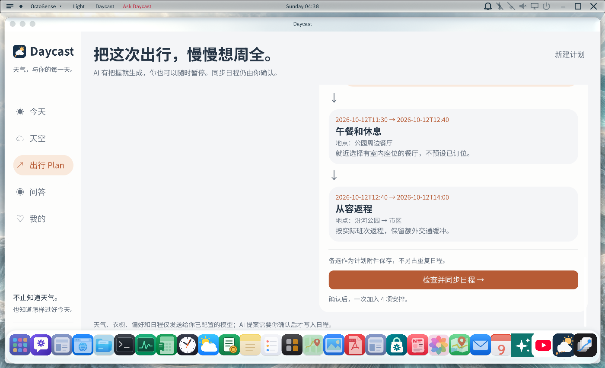
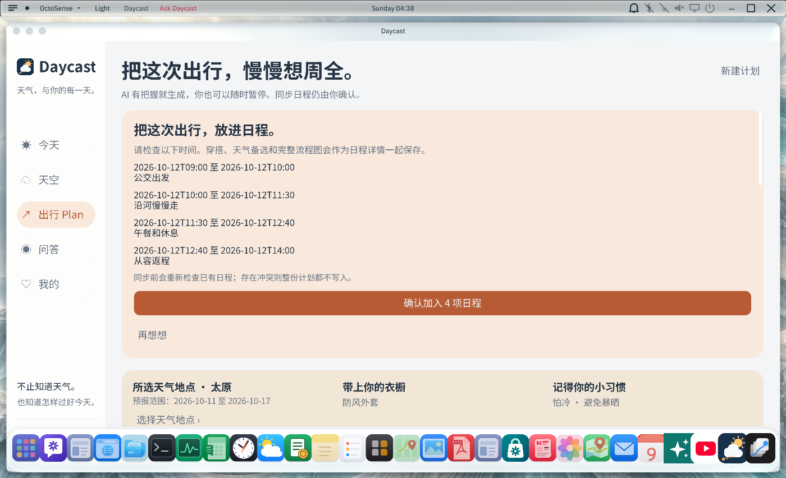
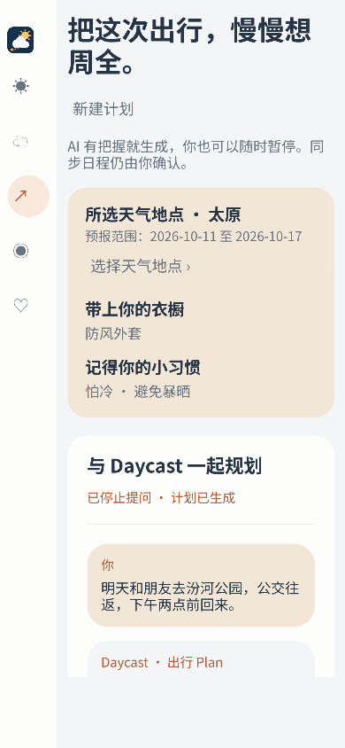
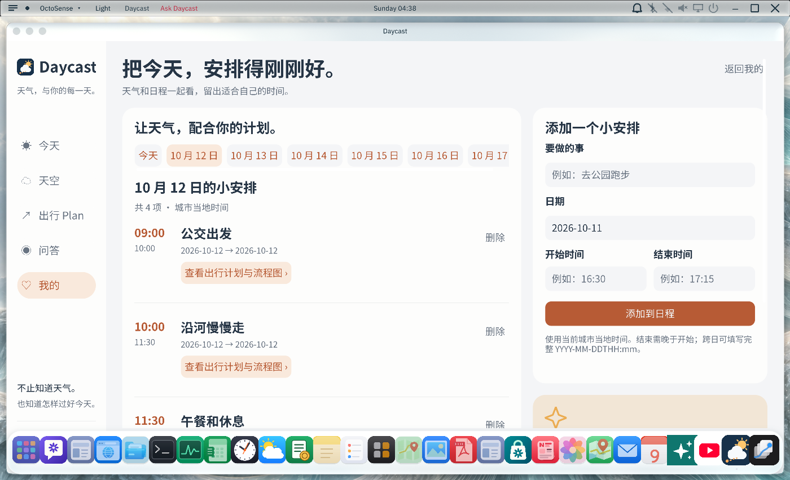
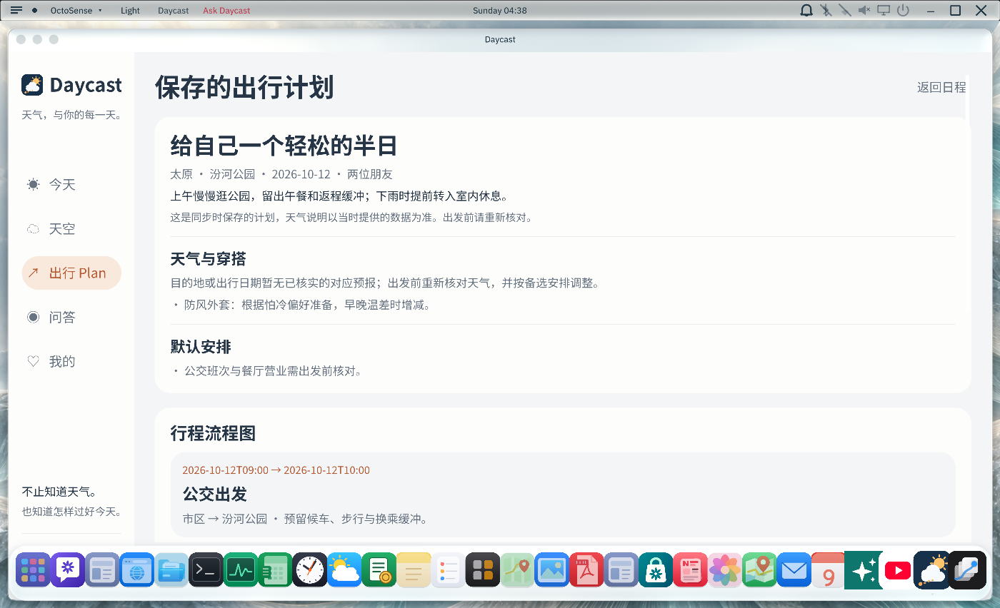

# 出行 Plan · 0.5.0

新增独立规划模式。AI 使用宿主的 `model.complete` 强模型和严格 JSON schema，结合用户需求、天气、实际衣橱、天气偏好与共享日程，自行判断是否足够安排好一份出行计划。每次回复只补充必要信息；信息足够直接生成，不设置固定问题数量。较早约束会压缩保留，并与最新明确更正一起作为上下文。

用户可从固定页头暂停；迟到的模型结果或校验结果不会恢复规划。未完成请求重启后恢复为暂停，需主动继续。已发出的服务商请求不保证被取消。正在同步日程时不提供暂停，避免把未知的写入结果当成取消。

计划显示生成依据、条件来源、默认安排、天气范围、已有衣物穿搭与天气备选分支。应用按经过校验的步骤绘制原生流程图；没有对应天气就标注待核实，不凭空填天气。默认安排可通过继续描述要求修改。

## 原生界面

以下为真实 Windows 原生界面截图，使用独立 QA 数据和结构化计划夹具；图片中的示例行程不作为真实 AI 生成或已查询公交/营业信息的证明。













独立 card-host 没有 shell 的尺寸回调；窄窗口测试副本补发一次相同尺寸回调，生产脚本不含测试夹具。真实 shell 的默认和最大化窗口另行复验。

## 日程同步

只同步到 Daycast 自己的日程表。点击「检查并同步日程」，检查全部时间，再确认加入，才调用宿主批量写入。宿主重新读取共享日程，检查所有项目后一次替换文件；任何冲突都不会先写部分。每项事件保存完整计划快照、穿搭、天气备选和可重绘的流程图，旧事件兼容。保存后可从事件打开完整计划。

同一版本重试幂等。已保存后被部分删除或修改时，应用提示检查已有日程，不补写重复项；同步超时不自动重试，用户核对后可再次确认。

## 已执行检查

在配套定制 OctoSense Windows 工作区执行：

```powershell
python -X utf8 tools/setup.py --check --cargo
cargo test --locked --offline --release -p octosense-daycast-service
cargo test --locked --offline --release -p octosense-llm-service --test weather_advice
cargo build --locked --offline --release -p octosense
cargo check --locked --offline --release -p octosense --features mobile-apps
```

- 页面/状态回归：34 项通过，包括既有功能与 7 项新增 Plan 测试。
- Plan 宿主：8 项通过，包括确认门槛、整批保存、冲突不部分写入、幂等、天气/衣橱/备选校验和旧日程兼容；同工作区的 4 项其他宿主测试通过、1 项真实天气网络测试按配置忽略。
- 原生布局：询问、暂停、继续、成品、流程图和确认卡已验证；320 与 390 像素布局通过，未测真机。
- 最终 release：实际确认后整批保存 4 项行程；每项完整附件已核对，从日程打开流程图通过。新建计划保留已同步日程，没有模型配置时显示错误并允许暂停。仅使用隔离 QA 目录。
- Windows 桌面默认 release 构建与 mobile-apps 特性编译检查通过。
- bundle 摘要重新生成，未创建新的 GitHub Release。

本仓库归档应用源码和宿主集成代码，没有独立 Cargo workspace。真实模型服务商输出质量、外部日历导出和 Android/iOS 真机未验证；配套宿主针对已有固定工作区集成，未声称适配最新 OctoSense 主分支。




