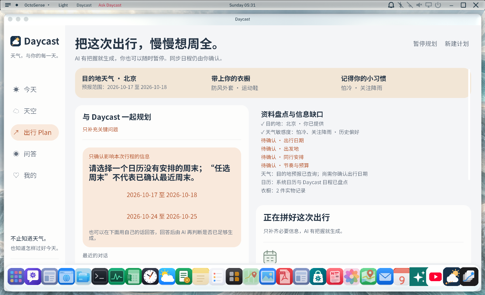
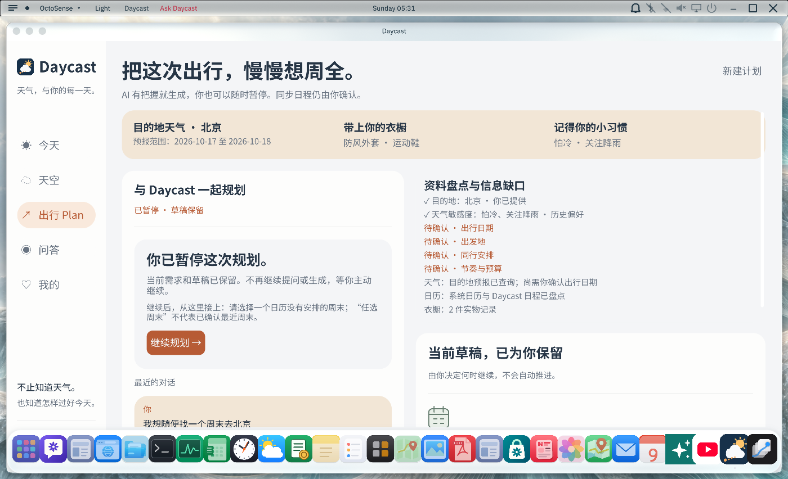
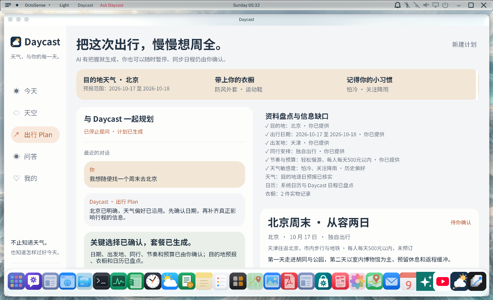
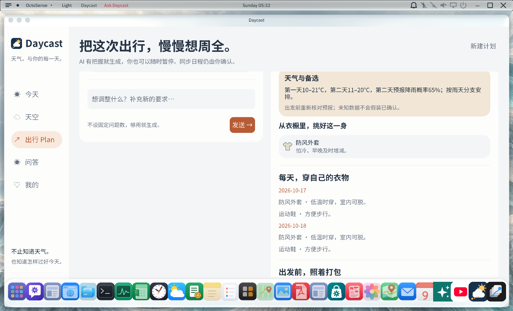
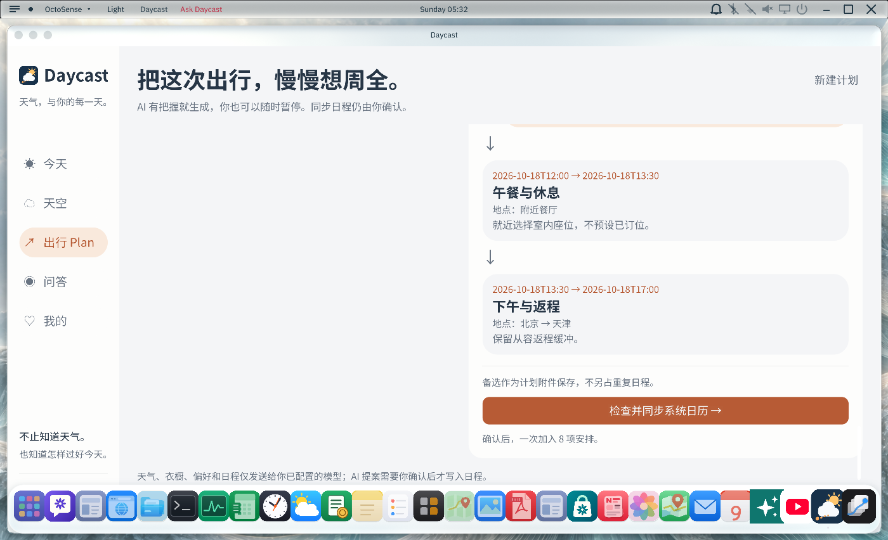
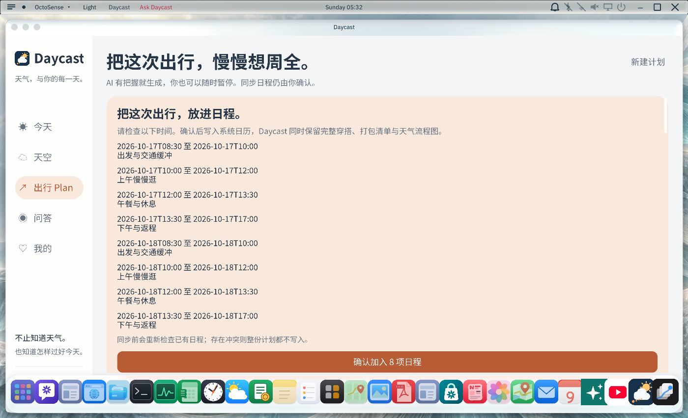

# 出行 Plan：置信度驱动规划（0.6.0）

用户进入出行 Plan 后，Daycast 汇总已知需求、目的地天气、个人衣橱、天气偏好，以及 Daycast 和 OctoSense 系统日历。宿主根据可核验的对话证据和资料判断是否具备生成条件，模型不能单独宣称“有把握”。信息缺口以少量选择题呈现；“找个周末”会给出日期选择，不自动选最近周末。用户可随时暂停，之后由用户主动继续。

达标后生成逐日行程、衣橱实物穿搭、打包清单、天气规则驱动的雨天/低温备选和流程图。生成结果还需经过目的地、日期、衣物、天气覆盖范围与日历冲突校验。用户检查完整安排并再次确认后，计划才写入日历。两套日历各自采用批量写入和冲突检查；重试同一版本保持幂等。Daycast 日程事件附带完整计划快照，可从已保存事件重新打开流程图。

天气变化复检仅在 Daycast 应用处于打开状态时运行（用户可启用周期检查）；发现差异只提出重检建议，用户确认后才替换计划。**不监测航班变化。**反馈只有在用户明确保存后才会更新天气偏好。

## 原生界面验证截图

这些截图来自隔离的 Windows QA 数据。计划内容由测试夹具提供，不证明真实模型生成质量、实时天气准确性、交通或营业信息。

## 宿主接口

- `daycast.plan.inventory`：同时读取 Daycast 与系统日历供冲突分析。
- `daycast.plan.assess`：依据用户消息、用户确认答案和可用资料计算准备度，并返回缺口；拒绝仅依赖模型自述的证据。
- `daycast.plan.validate`：重新校验目的地、日期、天气覆盖、衣橱和事件时间，不写入。
- `daycast.plan.sync`：需要用户确认；对两套日历分别执行批量同步和冲突保护。
- `daycast.plan.recheck`：比较行程天气基线与当前预报，只返回是否建议复核。

系统日历桥接位于 `host-integration/calendar-service/`，没有给 Daycast 增加通用日历写权限。两个日历文件分别原子替换，因此写入不是跨存储事务。计划同步时，如果第一套日历成功而第二套遇到外部并发变化，用户可能需要在界面重试；同一计划 ID 可幂等重试。

## 验证范围与限制

- `octosense-daycast-service`：21 项通过，1 项需真实 QWeather 密钥的网络测试按配置忽略。
- `weather_advice`：37 项通过，覆盖应用页面、状态、地点消歧和地理编码候选处理。
- 原生隔离 QA：模糊周末追问、暂停与继续；8 条示例日程分别写入两个隔离日历；检查计划附件、流程图和显式偏好反馈保存。
- 真实模型服务商生成质量没有验证。天气与地理编码使用 Open-Meteo；实时服务响应和长期未来天气的准确性不在本次保证范围内。
- 天气复检不在应用关闭时运行；没有航班数据源或航班监测。
- 本次最终微调后的 OctoSense release 可执行文件未能重新构建：Cargo 默认沙箱在外部 Rust Git checkout 遇到 Windows `PermissionDenied`，扩权构建请求未通过自动审查使用额度检查。此前已验证构建的 release 二进制不是本次最终源码版本。
- Android/iOS 设备和外部日历服务未验证；本次不创建 GitHub Release。

`README.md` 为英文摘要。配套宿主源码和接入说明见 [`host-integration`](../../host-integration/README.md)。
